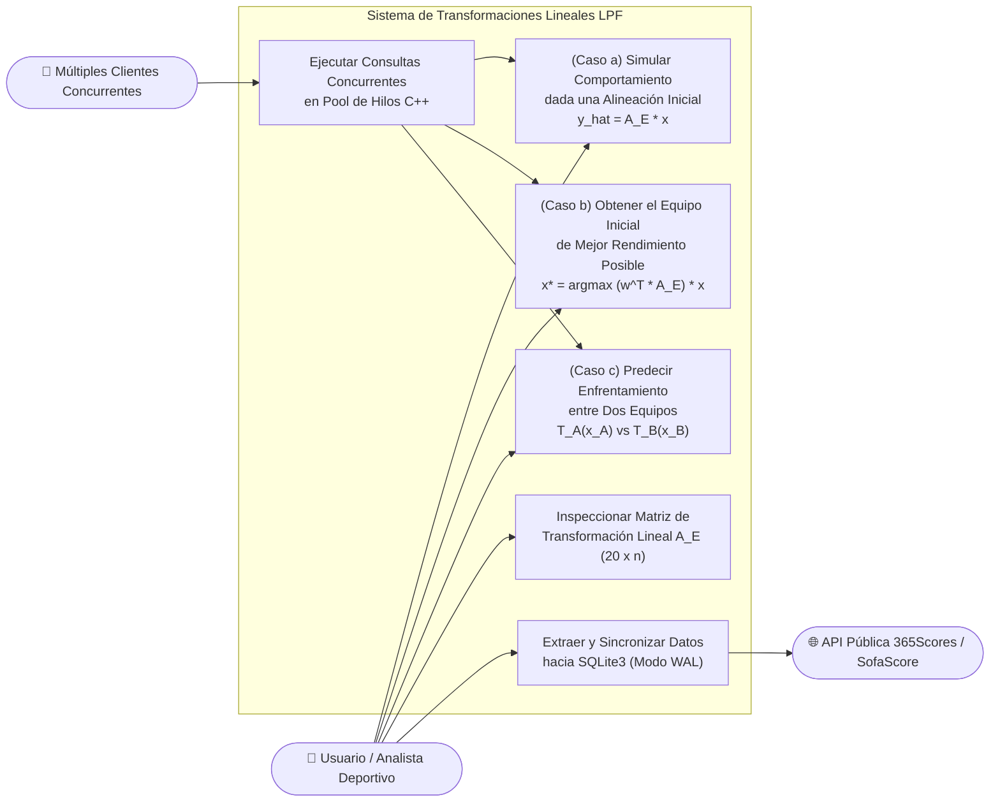
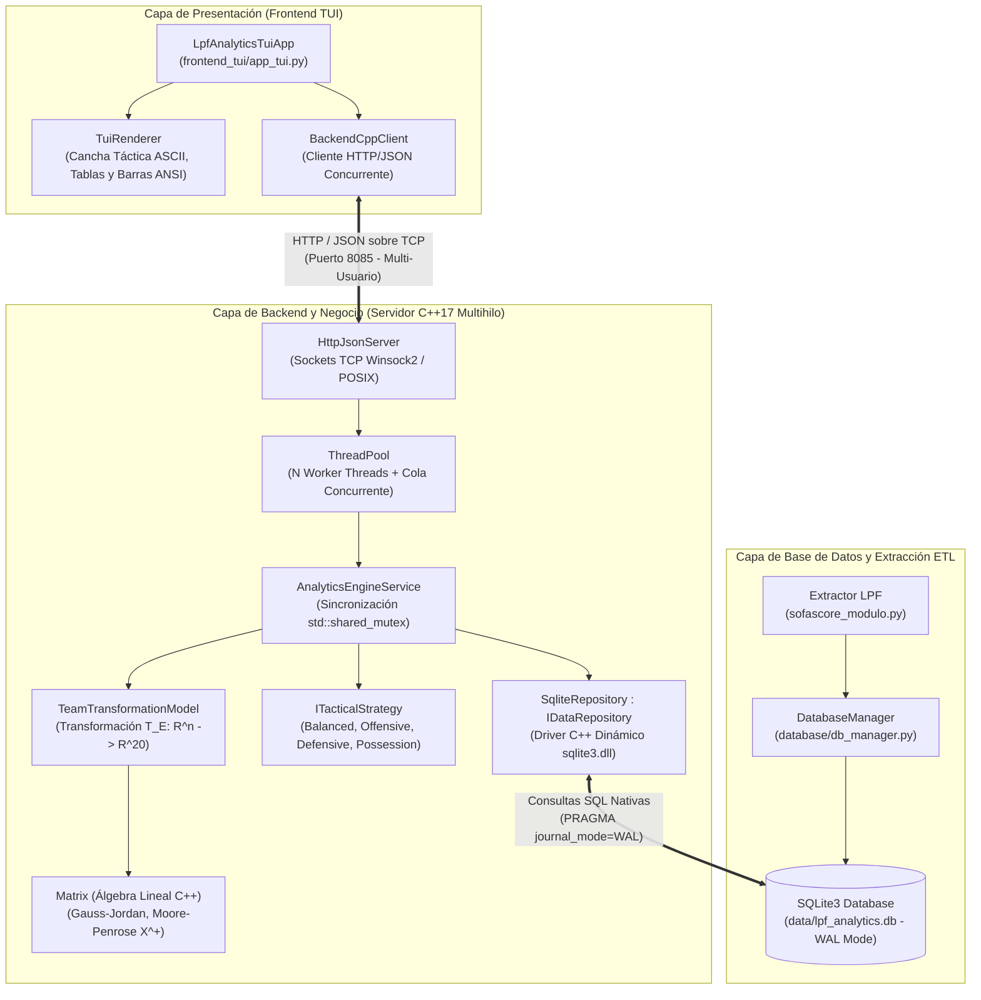
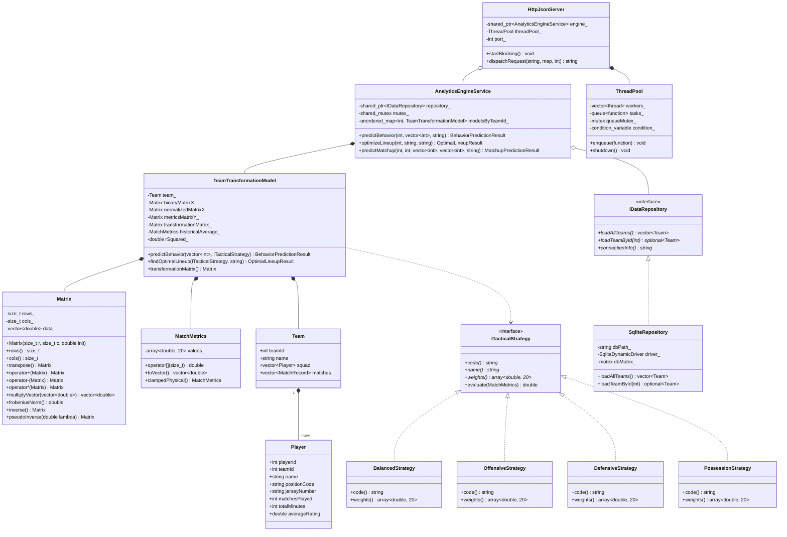
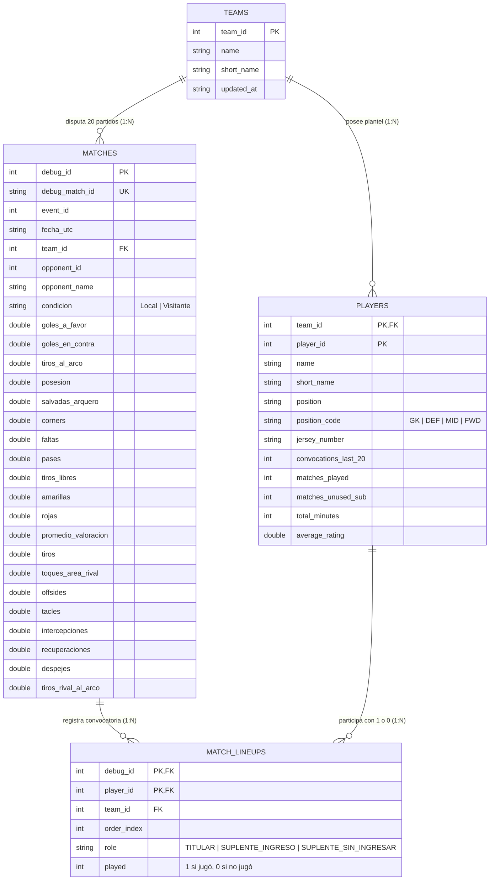

# Documentación de Ingeniería de Software — Sistema de Análisis y Predicción Táctica por Transformaciones Lineales (LPF)

**Nivel de Ingeniería:** Senior Software Architecture & Mathematical Modeling  
**Estándares de Referencia:**
- **Roger S. Pressman**, *Ingeniería del Software: Un Enfoque Práctico* (Diseño Arquitectónico, Modelo Incremental, Atributos de Calidad FURPS+, Cohesión y Acoplamiento).
- **Carlo Ghezzi, Mehdi Jazayeri & Dino Mandrioli**, *Fundamentals of Software Engineering* (Los 7 Principios Fundamentales de la Ingeniería de Software).
- **IEEE Std 830 / ISO/IEC/IEEE 29148** (Especificación de Requisitos de Software - SRS).
- **OMG Unified Modeling Language (UML 2.5)** (Diagramas de Casos de Uso, Clases, Secuencia, Componentes y Entidad-Relación).

---

## 1. Fundamentación en Ingeniería de Software (Pressman & Ghezzi)

### 1.1 Aplicación de los 7 Principios Fundamentales de Carlo Ghezzi

| Principio de Ghezzi | Aplicación Concreta en el Sistema |
| :--- | :--- |
| **1. Rigor y Formalidad** | Toda la lógica predictiva se fundamenta matemáticamente en espacios vectoriales finitos ($\mathbb{R}^n \to \mathbb{R}^{20}$), álgebra matricial, regularización de Tikhonov-Ridge y la Pseudoinversa de Moore-Penrose ($X^+$). Las precondiciones y postcondiciones de dominio garantizan invariantes físicos (ej. $\text{Posesión}_A + \text{Posesión}_B = 100\%$). |
| **2. Separación de Intereses (*Separation of Concerns*)** | División estricta en **3 capas independientes**: (1) **Frontend TUI** (`frontend_tui/app_tui.py`) enfocado exclusivamente en experiencia visual en consola; (2) **Backend C++17** (`backend_cpp/`) responsable del cómputo matricial, optimización combinatoria y concurrencia multihilo; (3) **Persistencia Relacional y ETL** (`database/` + `sofascore_modulo.py`) sobre SQLite3 en modo WAL. |
| **3. Modularidad** | Alta cohesión interna y bajo acoplamiento entre subsistemas (`lpf::math`, `lpf::domain`, `lpf::repository`, `lpf::services`, `lpf::concurrency`, `lpf::server`). Cada módulo puede compilarse y probarse unitariamente de forma aislada (`test_linear_algebra.cpp`). |
| **4. Abstracción** | Uso de interfaces abstractas puras en C++ (`IDataRepository`, `ITacticalStrategy`) y encapsulamiento de operaciones matriciales complejas detrás de la clase `Matrix` y `TeamTransformationModel`. |
| **5. Anticipación al Cambio** | El patrón *Strategy* permite agregar nuevos perfiles tácticos sin modificar el optimizador de alineaciones (Principio Abierto/Cerrado - SOLID). El patrón *Repository* permite migrar de SQLite3 a PostgreSQL sin alterar una sola línea del motor algebraico. |
| **6. Generalidad** | El motor de transformaciones lineales $T_E: \mathbb{R}^n \to \mathbb{R}^m$ funciona para cualquier plantel de $n$ jugadores y cualquier cantidad de partidos históricos, adaptando dinámicamente las dimensiones de $A_E \in \mathbb{R}^{20 \times n}$. |
| **7. Incrementalidad** | El sistema evoluciona desde el módulo de extracción de datos en Python hasta una arquitectura cliente-servidor multihilo con interfaz gráfica en terminal (TUI), preparada para escalar hacia clientes Web/Desktop consumiendo la misma API HTTP/JSON del servidor C++. |

### 1.2 Pirámide de Diseño y Atributos de Calidad de Roger S. Pressman

Siguiendo la metodología de Pressman, el diseño se estructura en cuatro niveles:
1. **Diseño de Datos:** Modelo relacional normalizado en Tercera Forma Normal (3FN) en SQLite3 (`teams`, `players`, `matches`, `match_lineups`) con *Write-Ahead Logging* (`WAL`) para lecturas concurrentes sin bloqueo.
2. **Diseño Arquitectónico:** Arquitectura Cliente-Servidor en 3 Capas con comunicación por sockets TCP (HTTP/JSON) y un *Thread Pool* nativo en C++17 (`std::thread`, `std::shared_mutex`, `std::condition_variable`).
3. **Diseño de Interfaz:** Interfaz Gráfica en Terminal (TUI) ergonómica que reduce la carga cognitiva mediante visualización de cancha táctica en ASCII/Unicode, tablas comparativas cromáticas y barras de probabilidad.
4. **Diseño a Nivel de Componentes:** Algoritmos numéricos en C++17 (`Matrix::inverse` con pivoteo parcial escalado, `Matrix::pseudoInverse` de Moore-Penrose, optimización por líneas posicionales y acoplamiento bilateral de Poisson).

---

## 2. Especificación de Requisitos de Software (SRS - IEEE 830 / ISO 29148)

### 2.1 Requerimientos Funcionales (RF)

- **RF-01 (Modelado de Vector de Alineación $x \in \{0, 1\}^n$):** Para cada equipo y cada partido, el sistema debe representar la alineación como un vector binario de dimensión $n$ (total de jugadores registrados del plantel), asignando $1$ a los jugadores que disputaron el encuentro (titulares iniciales y sustitutos que ingresaron) y $0$ a los convocados que permanecieron en el banco sin ingresar y a los no convocados.
- **RF-02 (Espacio Vectorial de Salida $\mathbb{R}^{20}$):** Por cada partido y equipo, el sistema debe modelar exactamente las siguientes 20 métricas:
  1. Goles a favor (`goles_a_favor`)
  2. Goles en contra (`goles_en_contra`)
  3. Tiros al arco (`tiros_al_arco`)
  4. Posesión (`posesion`)
  5. Salvadas (`salvadas_arquero`)
  6. Córners (`corners`)
  7. Faltas (`faltas`)
  8. Pases (`pases`)
  9. Tiros libres (`tiros_libres`)
  10. Amarillas (`amarillas`)
  11. Rojas (`rojas`)
  12. Promedio de valoración del equipo (`promedio_valoracion`)
  13. Tiros totales (`tiros`)
  14. Toques en el área rival (`toques_area_rival`)
  15. Offsides (`offsides`)
  16. Tacles (`tacles`)
  17. Intercepciones (`intercepciones`)
  18. Recuperaciones (`recuperaciones`)
  19. Despejes (`despejes`)
  20. Tiros del rival al arco propio (`tiros_rival_al_arco`)
- **RF-03 (Cálculo de la Matriz de Transformación Lineal por Equipo $A_E \in \mathbb{R}^{20 \times n}$):** El Backend en C++ debe calcular para cada equipo su matriz de transformación lineal $A_E$ mediante la Pseudoinversa de Moore-Penrose regularizada a partir de sus últimos 20 partidos de Liga Profesional.
- **RF-04 [Objetivo a] (Simulación de Comportamiento dada una Alineación Inicial):** Dado un equipo y un conjunto de jugadores iniciales seleccionados por el usuario ($x \in \{0, 1\}^n$), el sistema debe aplicar la transformación lineal $\hat{y} = T_E(x) = A_E \cdot x$ y devolver las 20 métricas esperadas junto con su comparación frente al promedio histórico del equipo y el aporte individual de cada jugador.
- **RF-05 [Objetivo b] (Obtención del Equipo Inicial de Mejor Rendimiento Posible):** Dado un equipo, una formación táctica (o selección automática de mejor formación) y un perfil táctico (`Balanceado`, `Ofensivo`, `Defensivo`, `Posesión`), el sistema debe hallar en C++ el vector óptimo de 11 titulares $x^* \in \{0, 1\}^n$ ($\|x^*\|_1 = 11$) que maximiza la funcional lineal $J(T_E(x)) = (w^T A_E) x$ respetando las restricciones posicionales (`1 GK + DEF + MID + FWD`), devolviendo los 11 titulares, los 7 suplentes sugeridos y el vector de 20 métricas esperadas.
- **RF-06 [Objetivo c] (Predicción de Partido entre Dos Equipos):** Dados dos equipos (Local $A$ y Visitante $B$), el sistema debe evaluar sus transformaciones lineales $T_A(x_A)$ y $T_B(x_B)$, acoplar bilateralmente sus métricas ofensivas y defensivas, calcular goles esperados ($xG_A, xG_B$), probabilidades de Victoria Local, Empate y Victoria Visitante, marcadores más probables y la comparativa de las 20 métricas lado a lado.
- **RF-07 (Inspección Matricial y Auditoría Matemática):** El sistema debe permitir visualizar la matriz $A_E \in \mathbb{R}^{20 \times n}$ de cada equipo, su coeficiente de determinación $R^2$ y su norma residual de Frobenius $\|Y - A_E X\|_F$.
- **RF-08 (Ingesta y Persistencia Relacional):** El sistema debe integrar los datos obtenidos en Python (`sofascore_modulo.py`) dentro de una base de datos relacional SQLite3 (`data/lpf_analytics.db`).
- **RF-09 (Restricción de Elegibilidad por Pertenencia Actual al Plantel):** El sistema debe distinguir entre jugadores que participaron históricamente en los últimos 20 partidos pero ya no pertenecen al equipo (`pertenece_actualmente = 0` / `currently_in_club = 0`, por transferencia o baja) y los jugadores del plantel actual (`currently_in_club = 1`). Los ex-jugadores integran la matriz histórica $A_E \in \mathbb{R}^{20 \times n}$ para no distorsionar las ecuaciones de los partidos pasados, pero **no son elegibles** ($x_j = 0$ fijo) para conformar alineaciones actuales ni el 11 óptimo en los casos **(a)**, **(b)** y **(c)**.

### 2.2 Requerimientos No Funcionales (RNF)

- **RNF-01 (Motor Matemático y Lógica en C++):** Toda la lógica del sistema, álgebra lineal, inversión matricial, pseudoinversa, optimización de alineaciones y predicción entre equipos debe estar implementada íntegramente en C++17 bajo el paradigma Orientado a Objetos.
- **RNF-02 (Concurrencia Multi-Usuario):** El Backend C++ debe implementar un servidor TCP/HTTP multihilo con un *Thread Pool* y bloqueos lectores/escritores (`std::shared_mutex`) capaz de procesar decenas de consultas simultáneas en paralelo sin condiciones de carrera (*race conditions*).
- **RNF-03 (Separación Física y Lógica de Capas):** Frontend, Backend y Base de Datos deben operar en módulos desacoplados comunicados mediante contratos bien definidos (API HTTP/JSON y SQL).
- **RNF-04 (Usabilidad en Terminal - TUI):** La primera versión del Frontend debe ejecutarse en terminal ofreciendo una interfaz gráfica textual con paneles, colores ANSI, representación visual de la cancha de fútbol y gráficos de barras.

---

## 3. Modelo Matemático de las Transformaciones Lineales

Sea un equipo $E$ con $n$ jugadores registrados en su plantel y $m = 20$ partidos históricos.

1. **Espacio de Alineaciones ($\mathbb{R}^n$) y Matriz de Diseño ($X$):**
   Para cada partido $k \in \{1, \dots, m\}$, definimos el vector binario de participación $x^{(k)} \in \{0, 1\}^n$ donde:
   $$x_j^{(k)} = \begin{cases} 1 & \text{si el jugador } j \text{ jugó en el partido } k \text{ (titular o suplente que ingresó)} \\ 0 & \text{si el jugador } j \text{ fue suplente sin ingresar o no fue convocado} \end{cases}$$
   Para que cualquier alineación inicial de 11 jugadores ($\|x\|_1 = 11$) conserve la invariancia de escala respecto a partidos donde ingresaron cambios ($\|x^{(k)}\|_1 \in [11, 16]$), definimos la matriz de alineaciones normalizada a 11 unidades activas $\tilde{X} \in \mathbb{R}^{n \times m}$:
   $$\tilde{X}_{j, k} = x_j^{(k)} \cdot \frac{11}{\sum_{i=1}^n x_i^{(k)}}$$

2. **Espacio de Métricas ($\mathbb{R}^{20}$) y Matriz de Observaciones ($Y$):**
   Cada columna $k$ de $Y \in \mathbb{R}^{20 \times m}$ contiene las 20 métricas observadas del equipo en el partido $k$.

3. **Obtención de la Matriz de la Transformación Lineal $A_E \in \mathbb{R}^{20 \times n}$:**
   Descomponemos $A_E = A_0 + \Delta A_E$, donde $A_0 \in \mathbb{R}^{20 \times n}$ es la transformación base canónica del plantel ($\frac{1}{11}\bar{y}_E$ ponderada por la continuidad y valoración individual de cada jugador para romper la colinealidad entre titulares que jugaron exactamente los mismos encuentros) y $\Delta A_E$ resuelve el sistema lineal de residuos $\Delta A_E \cdot \tilde{X} \approx Y - A_0 \tilde{X}$ mediante la **Pseudoinversa de Moore-Penrose con regularización de Tikhonov ($\lambda = 0.08$)**:
   $$\Delta A_E = (Y - A_0 \tilde{X}) \cdot \tilde{X}^+, \qquad \tilde{X}^+ = \tilde{X}^T (\tilde{X} \tilde{X}^T + \lambda I_n)^{-1}$$
   Por lo tanto, la transformación lineal del equipo queda unívocamente determinada por la matriz $A_E \in \mathbb{R}^{20 \times n}$:
   $$T_E(x) = A_E \cdot x$$
   Donde cada columna $j$ de $A_E$ es $T_E(e_j) \in \mathbb{R}^{20}$: la imagen del vector canónico $e_j$, que representa el aporte lineal directo del jugador $j$ a las 20 métricas del equipo.

---

## 4. Diagramas UML del Sistema

### 4.1 Diagrama de Casos de Uso (UML)



### 4.2 Diagrama de Arquitectura en 3 Capas y Componentes (UML)



### 4.3 Diagrama de Clases UML del Backend C++ (Paradigma Orientado a Objetos)



### 4.4 Diagrama de Secuencia UML — Ejecución Concurrente de Casos (a), (b) y (c)

```mermaid
sequenceDiagram
    autonumber
    actor User as Usuario (Frontend TUI)
    participant TUI as LpfAnalyticsTuiApp
    participant Server as HttpJsonServer (C++)
    participant Pool as ThreadPool (Worker C++)
    participant Engine as AnalyticsEngineService
    participant Model as TeamTransformationModel
    participant DB as SQLite3 (WAL)

    Note over Server,DB: Inicialización del Backend C++ y precálculo de matrices A_E = A_0 + Delta_Y * X^+
    Server->>DB: SELECT teams, players, matches, match_lineups
    DB-->>Server: 30 equipos, 1188 jugadores, 600 partidos
    Server->>Model: buildModel() -> Calcula Matrix::pseudoInverse() para cada equipo

    rect rgb(30, 50, 70)
        Note over User,Model: Caso (a): Ingresar equipo inicial y obtener comportamiento esperado
        User->>TUI: Selecciona equipo e ingresa 11 titulares (x in {0,1}^n)
        TUI->>Server: GET /api/predict-behavior?team_id=7272&players=...
        Server->>Pool: enqueue(handleClientConnection)
        Pool->>Engine: predictBehavior(7272, playerIds) [shared_lock]
        Engine->>Model: predictBehavior(playerIds) -> Multiplica y_hat = A_E * x
        Model-->>Engine: BehaviorPredictionResult (20 métricas + aportes)
        Engine-->>Server: JSON Response
        Server-->>TUI: HTTP 200 JSON
        TUI-->>User: Renderiza Cancha Táctica y Tabla Comparativa de 20 Métricas
    end

    rect rgb(35, 60, 45)
        Note over User,Model: Caso (b): Obtener el equipo inicial de mejor rendimiento posible
        User->>TUI: Selecciona equipo, estrategia y formación (ej. AUTO / 4-3-3)
        TUI->>Server: GET /api/optimize-lineup?team_id=866&strategy=BALANCED
        Server->>Pool: enqueue(handleClientConnection)
        Pool->>Engine: optimizeLineup(866, "BALANCED", "AUTO") [shared_lock]
        Engine->>Model: findOptimalLineup(strategy, "AUTO")
        Model-->>Engine: OptimalLineupResult (11 titulares x*, 7 suplentes, métricas T_E(x*))
        Engine-->>Server: JSON Response
        Server-->>TUI: HTTP 200 JSON
        TUI-->>User: Renderiza 11 Óptimo en Cancha, Suplentes y Mejora Porcentual
    end

    rect rgb(60, 40, 60)
        Note over User,Model: Caso (c): Predicción de partido entre dos equipos (Equipo A vs Equipo B)
        User->>TUI: Selecciona Equipo A (Local) y Equipo B (Visitante)
        TUI->>Server: GET /api/predict-matchup?team_a_id=866&team_b_id=868
        Server->>Pool: enqueue(handleClientConnection)
        Pool->>Engine: predictMatchup(866, 868) [shared_lock]
        Engine->>Model: Evalúa T_A(x_A) y T_B(x_B) + Acoplamiento Bilateral y Poisson
        Model-->>Engine: MatchupPredictionResult (Probabilidades, xG, 20 métricas acopladas)
        Engine-->>Server: JSON Response
        Server-->>TUI: HTTP 200 JSON
        TUI-->>User: Renderiza Barra de Probabilidades, Marcadores y Duelo de 20 Métricas
    end
```



### 4.5 Diagrama Entidad-Relación (DER) de la Base de Datos SQLite3



---

## 5. Guía de Compilación, Ejecución y Pruebas (100% Dinámica Multi-Dispositivo)

Todos los scripts y módulos resuelven sus rutas de forma **dinámica** a partir de la ubicación del proyecto (`__file__`, `%~dp0`, `$PSScriptRoot` y `GetModuleFileNameA`), sin depender de letras de unidad ni rutas de usuario fijas.

### 5.1 Compilar el Backend C++17, Inicializar SQLite3 y Ejecutar Tests (Automático)
```powershell
.\compilar_cpp.ps1
```
*(Detecta automáticamente la instalación de Python, copia `sqlite3.dll`, localiza `g++.exe` en PATH/CLion/MSYS2/MinGW, compila los ejecutables estáticos y corre la suite de pruebas).*

### 5.2 Iniciar la Interfaz Gráfica en Terminal (Frontend TUI)
- **Desde Explorador de Archivos o Terminal (Windows):**
  ```powershell
  .\iniciar_sistema.bat
  ```
- **Modo Interactivo directo con Python:**
  ```powershell
  py frontend_tui/app_tui.py
  ```
- **Modo Demostración Completa Automática** (ejecuta y muestra en terminal los casos `a`, `b`, `c` y el benchmark de concurrencia multi-usuario):
  ```powershell
  py frontend_tui/app_tui.py --demo
  ```
